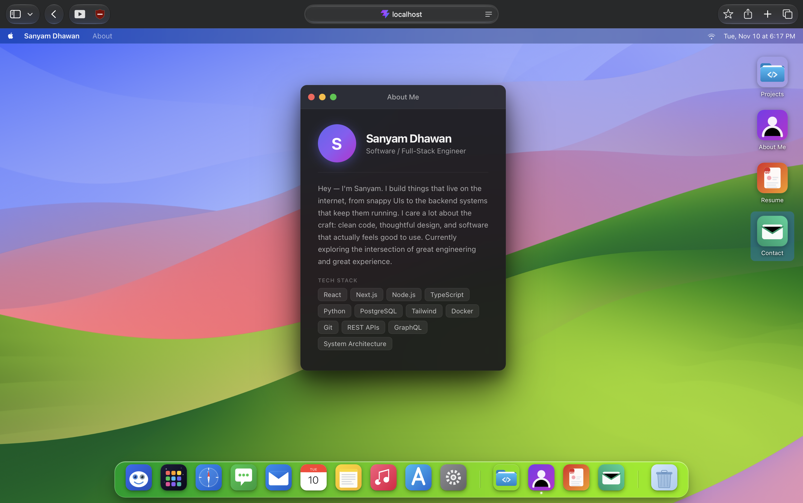

# Sanyam Dhawan — Portfolio

An interactive macOS Sonoma-style portfolio built with React and Vite. The site presents projects, experience, resume, and contact details inside a desktop-style interface with draggable windows, a dock, animated wallpaper, and glassmorphism styling.

## Features

- macOS-inspired desktop, menu bar, dock, and Finder-style Projects window
- Draggable and maximizable windows with focus/z-index management
- Animated wallpaper video
- Embedded project applications and resume PDF
- Responsive mobile guard recommending a desktop-sized screen
- Reduced-motion support for dock animations

## Tech stack

- React 18
- Vite 6
- Plain JSX and CSS
- Inline SVG icons
- No backend, database, router, or external UI framework

## Project structure

```text
src/
├── App.jsx                 # Application shell and window registry
├── main.jsx                # React entry point
├── index.css               # Global layout, glassmorphism, and responsive styles
└── components/
    ├── Window.jsx          # Reusable draggable/maximizable window
    ├── ProjectsContent.jsx # Finder-style project list and project metadata
    ├── Desktop.jsx         # Desktop icons
    ├── Dock.jsx            # Dock, hover magnification, and app toggles
    ├── MenuBar.jsx         # Menu bar and live clock
    ├── Wallpaper.jsx       # Background video
    ├── AboutContent.jsx    # About window content
    ├── ContactContent.jsx  # Contact links
    ├── Toast.jsx           # Welcome notification
    └── icons.jsx           # Reusable SVG icons and gradients

public/
├── wallpaper.mov
└── Sanyam_Dhawan_Resume.pdf
```

## Screenshot



## License

This portfolio is personal work by Sanyam Dhawan. Contact the author before reusing its content, branding, or personal assets.
